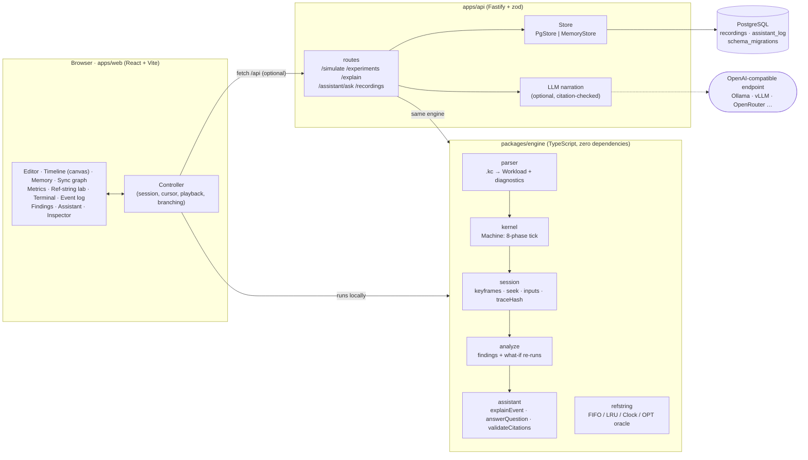

# Architecture

KernelCraft has three layers with one-way dependencies:

- **Engine:** a pure simulation library.
- **API:** HTTP access, persistence and optional LLM narration.
- **UI:** an IDE-style client.

The UI and the API both depend on the engine. Neither the engine nor the UI depends on the API: the UI works fully offline and uses the API only for shared recordings and narration.



## Why the engine runs in the browser

Stepping, scrubbing and branching need sub-millisecond access to machine state. A round trip per tick would make the timeline sluggish and the UI would depend on a server.

Because the engine is deterministic and dependency-free, the browser and the server run *the same code*. A run recorded in the browser and verified by the API must produce the same trace hash. The API's `verify` endpoint, and the end-to-end test that saves and then verifies a recording, check exactly this.

## Data flow of a run

1. **Parse.** The editor's text goes through `parseWorkload` on every keystroke, and the diagnostics are shown in the gutter.
2. **Run.** A `Session` executes the workload to completion. The controller keeps a second, finished `Machine` that holds the full event log, the per-tick timeline and the analysis, so the UI can draw the recorded future greyed out.
3. **Analyse.** `analyze` scans the log and runs each finding's experiment by executing a modified workload with `runToEnd`.
4. **Navigate.** Scrubbing calls `session.seek(t)`: restore the nearest keyframe, then re-step. Every view reads the session machine, so the views always show the state that was actually computed at the cursor.
5. **Inject.** An operator action goes through `session.inject`: it truncates the future, records the input, applies it and re-runs. This creates a new branch, and the analysis is recomputed.
6. **Persist.** Saving posts `{source, inputs}`. The API re-executes the run itself and stores the hash it computes; it never trusts the client's hash.

## Determinism contract

Four rules keep runs reproducible:

- There is no `Math.random`, no wall clock, and no iteration over unordered collections that affects behaviour.
- Ties are broken by explicit keys: tid order, core order, and a monotonically increasing ready-queue sequence number.
- Machine state is plain JSON, so it can be snapshotted with `structuredClone` and compared byte for byte in tests.
- `traceHash` covers every visible event (id, tick, type, thread, core, data) plus the final tick and status.

## Package layout

```
packages/engine/          simulation library
  src/types.ts            config, ops, runtime state, events
  src/parser.ts           .kc language → Workload, line/column diagnostics
  src/kernel.ts           Machine: scheduling, paging, TLB, sync, races, deadlock
  src/session.ts          keyframes, seek, recorded inputs, branching, traceHash
  src/metrics.ts          per-thread and system metrics
  src/analyze.ts          findings, counterfactual experiments, applyConfigPatch
  src/assistant.ts        explanations and question answering with citations
  src/refstring.ts        independent replacement-policy oracle (incl. OPT)
  src/samples.ts          the built-in sample workloads
  test/                   78 deterministic tests
apps/api/                 Fastify server
  src/app.ts              routes, validation, error model, static hosting
  src/store.ts            PgStore (parameterised SQL) and MemoryStore
  src/migrate.ts          transactional migrations under an advisory lock
  src/llm.ts              optional narration with citation validation
  migrations/             SQL
  test/                   API tests + real-PostgreSQL integration tests
apps/web/                 React UI
  src/lib/controller.ts   all UI state, playback, injections, recordings
  src/lib/terminal.ts     terminal command interpreter
  src/components/         editor, timeline (canvas), memory, sync, metrics, lab, panels
e2e/                      Playwright workflows against the real UI + API
samples/                  the sample workloads as .kc files
```

## Security and robustness

- **Input validation:** every API input is validated by zod. Config patches use a strict schema, and metric keys are matched against an allow-list regex.
- **Bounded simulations:** sources are capped at 100k characters. The parser rejects runaway `repeat` expansions before allocating them, and runs are bounded by `maxticks`, the thread limit and the instruction limit.
- **SQL:** every query is parameterised. Ids are checked against a UUID pattern before reaching the database, and the database enforces its own check constraints.
- **LLM output:** it is never trusted. A narration is shown only if every citation names a real event from the supplied evidence; otherwise the deterministic answer is returned along with the reason.
- **Not included:** authentication and rate limiting. KernelCraft is a single-user lab, so put it behind your own gateway before exposing recordings publicly.
